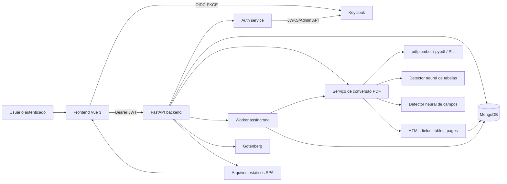
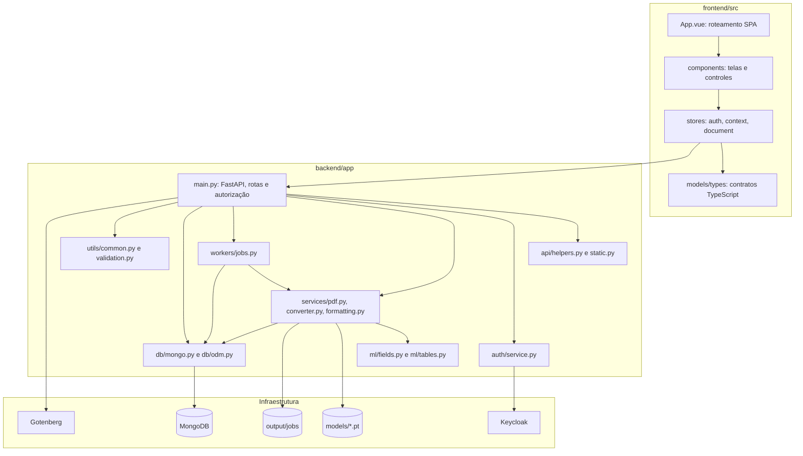
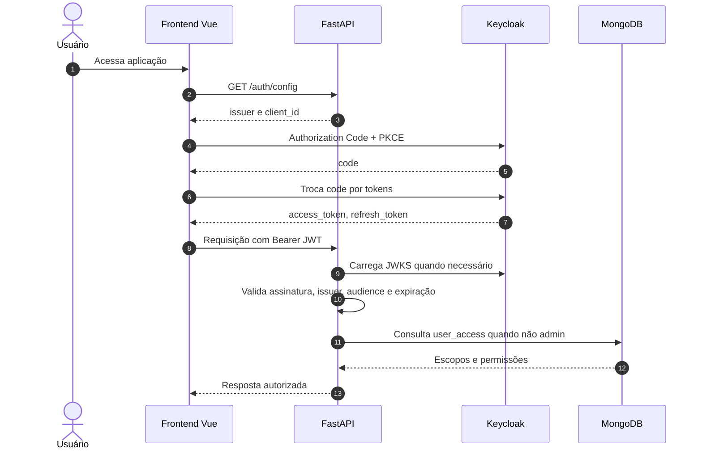
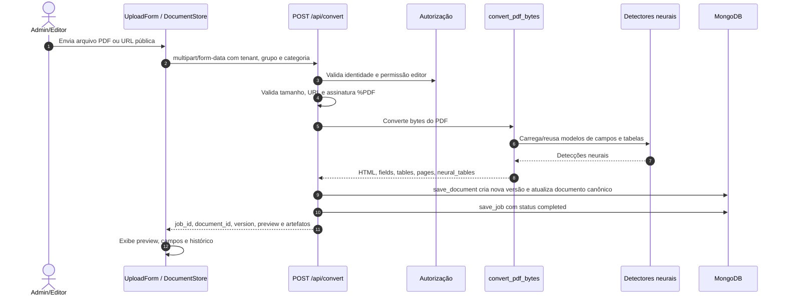
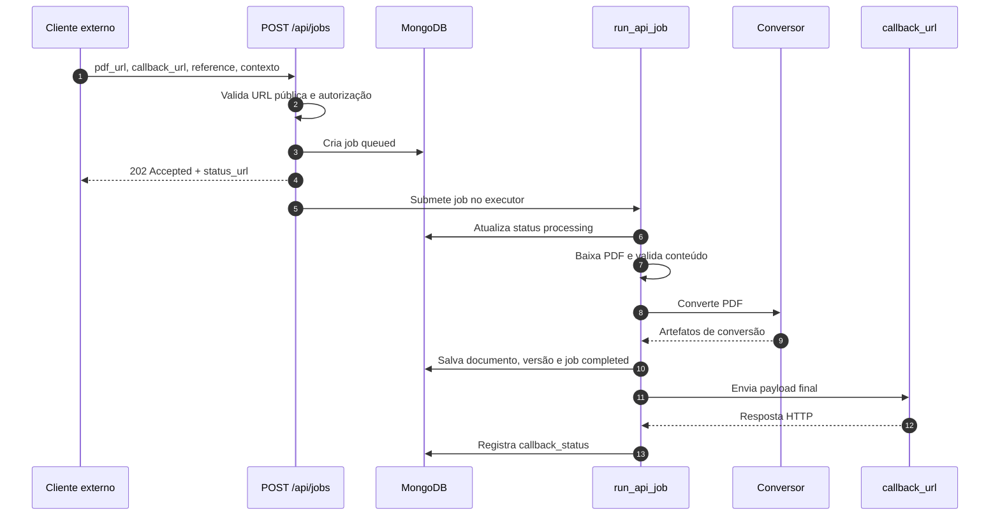
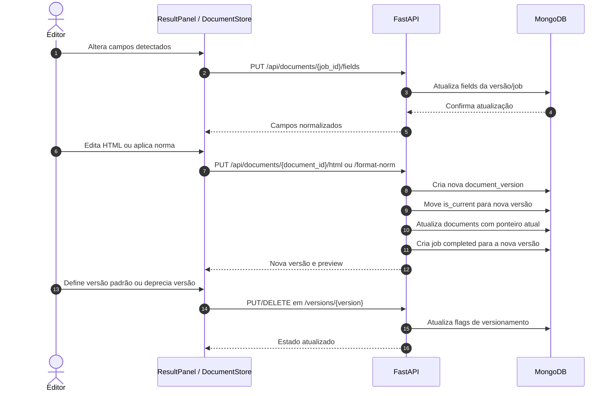
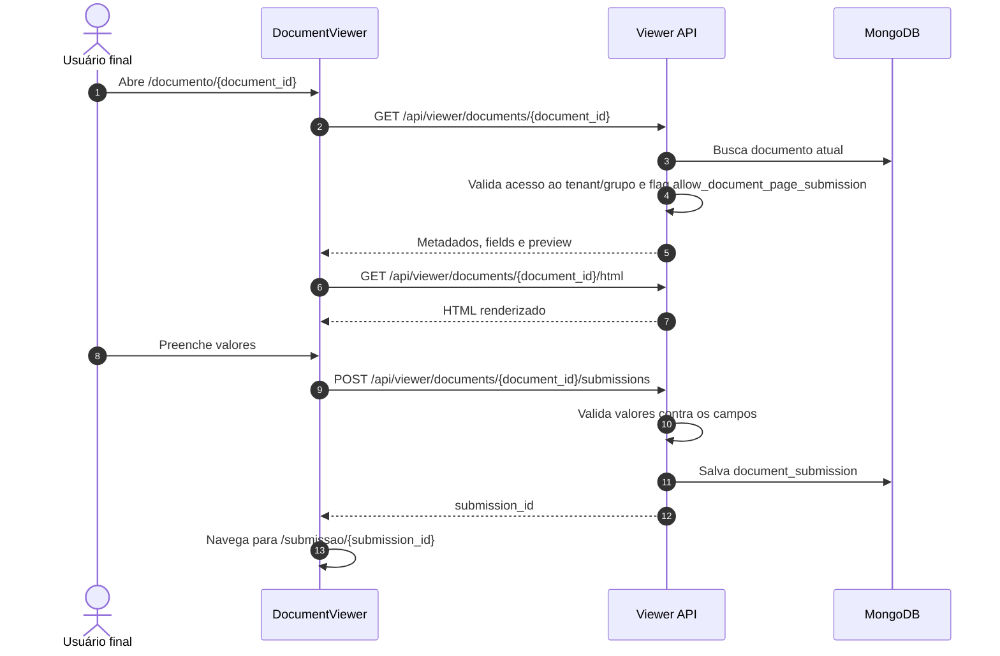
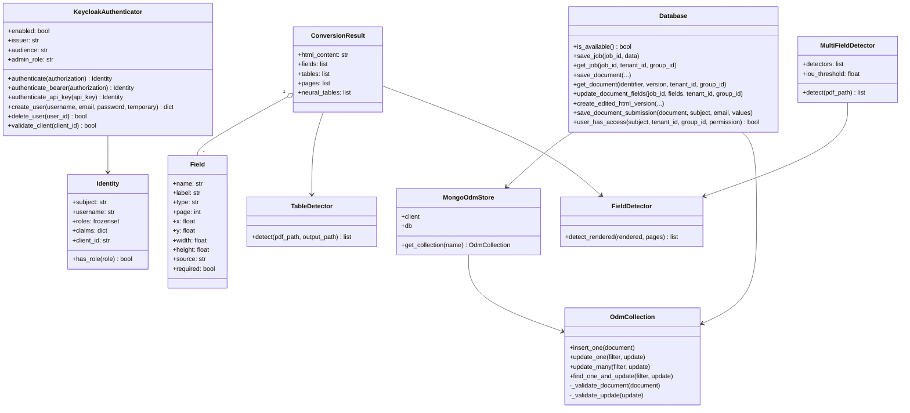
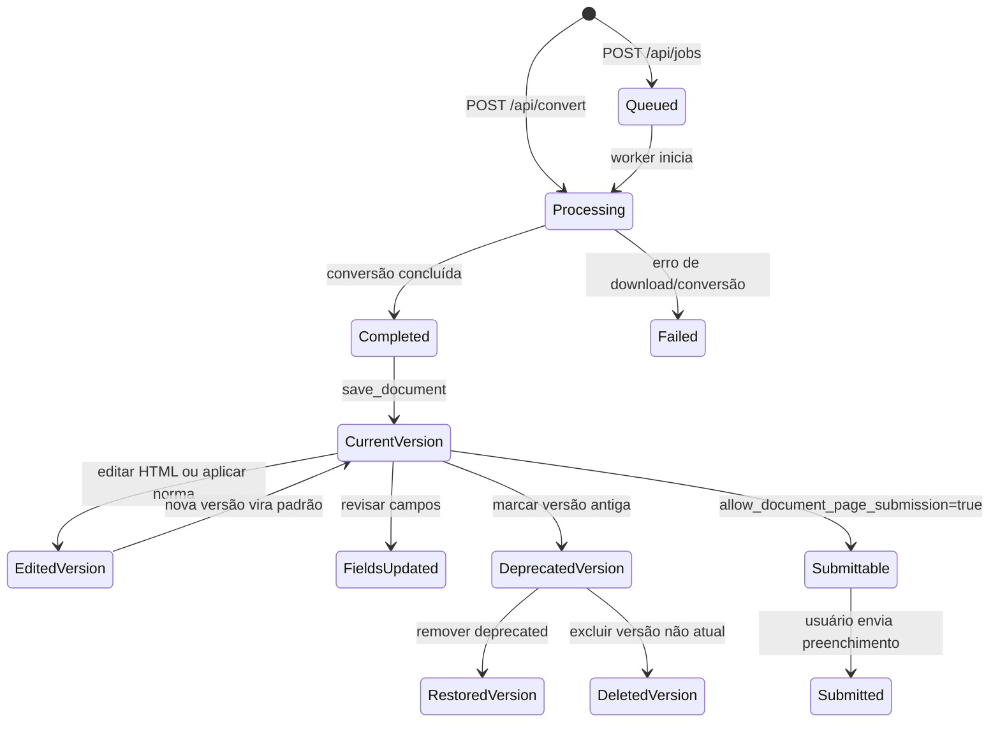

# PDF Neural - Documentação técnica

Este documento descreve a arquitetura, os principais processos de negócio e os modelos de dados do PDF Neural. Os diagramas usam Mermaid para permanecerem visuais e versionáveis em Markdown.

## Visão geral

O PDF Neural é uma aplicação full-stack para converter PDFs administrativos em HTML editável, detectar campos preenchíveis e tabelas, versionar documentos e permitir o preenchimento posterior por usuários autorizados.

A aplicação é composta por:

- Frontend Vue 3 + TypeScript + Pinia, servido pelo próprio backend em produção.
- Backend FastAPI em Python, responsável por autenticação, autorização, APIs, conversão e persistência.
- MongoDB, acessado por uma camada ODM leve baseada em Pydantic.
- Keycloak, usado como provedor OIDC/JWT e administração de usuários.
- Gotenberg, usado para converter HTML em PDF.
- Modelos neurais locais para detecção de campos e tabelas.
- Worker em `ThreadPoolExecutor` para jobs assíncronos de conversão por URL.

## Arquitetura visual



## Camadas e responsabilidades



## Componentes principais

### Frontend

O frontend organiza a experiência em rotas controladas por `App.vue`:

- `/documentos`: tela administrativa de conversão, histórico, edição de campos e versões.
- `/usuarios`: administração de acesso, disponível apenas para administradores.
- `/preenchidos`: consulta administrativa de submissões.
- `/documentos-disponiveis`: documentos que usuários podem preencher.
- `/documento/{document_id}`: visualizador/preenchimento de documento.
- `/submissao/{submission_id}`: visualização de submissão salva.

Stores Pinia:

- `auth`: inicializa OIDC, executa login PKCE, renova sessão e injeta `Authorization: Bearer`.
- `context`: carrega tenants, grupos, categorias e histórico de documentos.
- `document`: mantém documento atual, campos, preview HTML, versões, submissões e operações de edição.
- `fieldEditor` e `modals`: estados auxiliares para edição visual e modais.

### Backend

O backend usa FastAPI com rotas concentradas em `backend/app/main.py`. A API valida escopo de tenant/grupo, permissões e payloads antes de acionar serviços ou persistência.

Responsabilidades principais:

- Autenticação Bearer JWT via Keycloak e API Key via `X-API-Key`.
- Autorização por tenant, grupo e permissão (`reader` ou `editor`).
- Conversão síncrona de PDF (`POST /api/convert`).
- Conversão assíncrona por URL (`POST /api/jobs`).
- Versionamento de documentos e edição de HTML/campos.
- Disponibilização de documentos para preenchimento.
- Registro e consulta de submissões.
- Administração de tenants, grupos, categorias, usuários e API Keys.

### Persistência

O MongoDB é acessado por `Database` em `backend/app/db/mongo.py`. As coleções são validadas por modelos Pydantic em `backend/app/db/odm.py`.

Coleções principais:

- `documents`: ponteiro canônico do documento atual.
- `document_versions`: histórico versionado com HTML e metadados.
- `jobs`: status e resultado de conversões.
- `tenants`, `tenant_groups`, `document_categories`: organização multi-tenant.
- `user_access`: permissões por usuário, tenant e grupo.
- `api_keys`: chaves hashed para integrações.
- `document_submissions`: preenchimentos salvos por usuários.
- `images`: imagens extraídas do PDF associadas ao job.

## Processo: login e autorização



Regras importantes:

- Administradores são identificados pela role configurada em `KEYCLOAK_ADMIN_ROLE`, por padrão `pdf-admin`.
- Usuários comuns precisam de acesso explícito em `user_access`.
- API Keys são autenticadas por hash SHA-256 e podem restringir `tenant_id` e `group_id` via claims internas.
- Permissões `editor` são exigidas para conversão, edição, exclusão e versionamento.

## Processo: conversão síncrona de PDF



## Processo: conversão assíncrona por URL



## Processo: edição, versionamento e publicação



## Processo: preenchimento de documento



## Diagrama de classes



## Diagrama de banco de dados

```mermaid
erDiagram
    TENANTS {
        string tenant_id PK
        string name
        object metadata
        datetime created_at
        datetime updated_at
    }

    TENANT_GROUPS {
        string tenant_id FK
        string group_id PK
        string name
        object metadata
        datetime created_at
        datetime updated_at
    }

    DOCUMENT_CATEGORIES {
        string tenant_id FK
        string group_id FK
        string category_id PK
        string name
        object metadata
        datetime created_at
        datetime updated_at
    }

    USER_ACCESS {
        string subject PK
        string tenant_id FK
        string group_id FK
        string permission
        string username
        datetime created_at
        datetime updated_at
    }

    API_KEYS {
        string client_id
        string name
        string key_hash PK
        string tenant_id FK
        string group_id FK
        boolean active
        datetime created_at
        datetime revoked_at
    }

    DOCUMENTS {
        string document_id PK
        string job_id
        string current_job_id
        int current_version
        string tenant_id FK
        string group_id FK
        string category_id FK
        string content_hash
        object metadata
        array fields
        array tables
        array pages
        array neural_tables
        boolean is_current
        boolean single_submission_per_user
        boolean allow_document_page_submission
        datetime created_at
        datetime updated_at
    }

    DOCUMENT_VERSIONS {
        string document_id FK
        string job_id PK
        int version
        boolean is_current
        boolean deprecated
        string tenant_id FK
        string group_id FK
        string category_id FK
        string html_content
        object metadata
        array fields
        array tables
        array pages
        array neural_tables
        string format_norm
        int edited_from_version
        datetime created_at
    }

    JOBS {
        string job_id PK
        string status
        string tenant_id FK
        string group_id FK
        string category_id FK
        object result
        object reference
        boolean sync
        string callback_status
        datetime created_at
        datetime updated_at
    }

    DOCUMENT_SUBMISSIONS {
        string submission_id PK
        string document_id FK
        string job_id FK
        int version
        string tenant_id FK
        string group_id FK
        string subject
        string email
        object values
        datetime created_at
    }

    IMAGES {
        string job_id FK
        string image_key
        string data_hash PK
        string base64_data
        string content_type
        datetime created_at
    }

    TENANTS ||--o{ TENANT_GROUPS : possui
    TENANT_GROUPS ||--o{ DOCUMENT_CATEGORIES : organiza
    TENANTS ||--o{ USER_ACCESS : autoriza
    TENANT_GROUPS ||--o{ USER_ACCESS : restringe
    TENANTS ||--o{ API_KEYS : emite
    TENANT_GROUPS ||--o{ API_KEYS : restringe
    TENANTS ||--o{ DOCUMENTS : contem
    TENANT_GROUPS ||--o{ DOCUMENTS : agrupa
    DOCUMENT_CATEGORIES ||--o{ DOCUMENTS : classifica
    DOCUMENTS ||--o{ DOCUMENT_VERSIONS : versiona
    DOCUMENT_VERSIONS ||--|| JOBS : materializa
    DOCUMENTS ||--o{ DOCUMENT_SUBMISSIONS : recebe
    DOCUMENT_VERSIONS ||--o{ DOCUMENT_SUBMISSIONS : origem
    JOBS ||--o{ IMAGES : extrai
```



## Ciclo de vida do documento



## Contratos de dados importantes

### Campo detectado

Um campo é armazenado como objeto dentro de `fields` em documentos, versões e jobs.

Campos comuns:

- `name`: identificador do campo.
- `label`: texto exibido para edição/preenchimento.
- `type`: `text`, `date`, `email`, `tel`, `number`, `checkbox`, `radio`, `textarea`, `time`, `password`, `select`.
- `page`, `x`, `y`, `width`, `height`: geometria na página.
- `source`: origem da detecção, como `acroform`, `inferred` ou neural.
- `required`: obrigatoriedade.
- `options` e `option_boxes`: opções e coordenadas de rádios.
- `group_id` e `group_label`: agrupamento de checkboxes.

### Documento e versão

O documento canônico em `documents` contém o estado atual para listagem e abertura rápida. Cada alteração relevante cria ou atualiza dados em `document_versions`:

- Conversão cria uma nova versão com HTML completo.
- Edição de HTML cria uma nova versão e troca `is_current`.
- Alteração de campos atualiza os campos da versão ligada ao `job_id`; se a versão for atual, também atualiza `documents`.
- Definição de versão padrão sincroniza `documents` com a versão escolhida.
- Versões `deprecated` não podem virar padrão enquanto marcadas.

## APIs por domínio

### Autenticação e identidade

- `GET /auth/config`
- `GET /api/me`

### Conversão e jobs

- `POST /api/convert`
- `POST /api/jobs`
- `GET /api/jobs`
- `GET /api/jobs/{job_id}`
- `GET /jobs/{job_id}/html/index.html`
- `POST /api/pdf/html`

### Documentos e versões

- `GET /api/documents`
- `GET /api/documents/{document_id}`
- `DELETE /api/documents/{document_id}`
- `PUT /api/documents/{job_id}/fields`
- `PUT /api/documents/{document_id}/name`
- `PUT /api/documents/{document_id}/category`
- `PUT /api/documents/{document_id}/html`
- `PUT /api/documents/{document_id}/format-norm`
- `GET /api/documents/{document_id}/versions`
- `GET /api/documents/{document_id}/versions/current`
- `GET /api/documents/{document_id}/versions/{version}`
- `PUT /api/documents/{document_id}/versions/{version}/current`
- `PUT /api/documents/{document_id}/versions/{version}/deprecated`
- `DELETE /api/documents/{document_id}/versions/{version}/deprecated`
- `DELETE /api/documents/{document_id}/versions/{version}`

### Preenchimento e submissões

- `GET /api/public/viewer/documents/{document_id}`
- `GET /api/viewer/documents`
- `GET /api/viewer/documents/{document_id}`
- `GET /api/viewer/documents/{document_id}/html`
- `POST /api/viewer/documents/{document_id}/submissions`
- `GET /api/viewer/submissions`
- `GET /api/viewer/submissions/{submission_id}`
- `GET /api/viewer/submissions/{submission_id}/html`
- `GET /api/admin/submissions`

### Administração

- `GET /api/tenants`
- `POST /api/tenants`
- `GET /api/tenants/{tenant_id}/groups`
- `POST /api/tenants/{tenant_id}/groups`
- `GET /api/tenants/{tenant_id}/groups/{group_id}/categories`
- `POST /api/tenants/{tenant_id}/groups/{group_id}/categories`
- `GET /api/users/access?tenant_id={tenant_id}` (filtro opcional por tenant)
- `GET /api/users/{subject}/access`
- `POST /api/users`
- `PUT /api/users/{subject}/access`
- `DELETE /api/users/{subject}/access`
- `DELETE /api/users/{subject}`
- `GET /api/api-keys`
- `POST /api/api-keys`
- `POST /api/api-keys/revoke`

## Operação e configuração

Variáveis relevantes:

- `HOST`, `PORT`: endereço do backend.
- `MONGO_URI`: conexão MongoDB obrigatória para a maioria das APIs.
- `GOTENBERG_URL`: serviço usado em `/api/pdf/html`.
- `AUTH_ENABLED`: permite modo desenvolvimento quando desativado.
- `KEYCLOAK_ISSUER`, `KEYCLOAK_AUDIENCE`, `KEYCLOAK_ADMIN_ROLE`: validação OIDC.
- `KEYCLOAK_ADMIN_URL`, `KEYCLOAK_ADMIN_CLIENT_ID`, `KEYCLOAK_ADMIN_CLIENT_SECRET`: administração de usuários/clientes.
- `TABLE_MODEL`, `FIELD_MODEL`, `FIELD_MODELS`: checkpoints neurais.
- `NEURAL_ENABLED`, `NEURAL_REQUIRED`, `NEURAL_THRESHOLD`, `NEURAL_MIN_CONFIDENCE`: comportamento dos detectores.
- `PDF_WORKERS`: concorrência do executor de jobs.
- `PUBLIC_BASE_URL`: base usada em URLs de retorno.

Fluxo local típico:

```bash
python3 -m venv .venv
source .venv/bin/activate
pip install -r requirements.txt
python -m backend.app.main
```

Frontend em desenvolvimento:

```bash
npm install --prefix frontend
./scripts/dev.sh
```

Build de produção:

```bash
npm --prefix frontend run build
```

## Segurança e limites

- PDFs remotos precisam ser URLs públicas HTTP/HTTPS.
- Endereços locais ou privados são bloqueados na validação de URL.
- Tamanho máximo de PDF: 30 MB.
- Payloads JSON possuem limites específicos por rota.
- Preview HTML passa por resposta com headers de segurança.
- Chaves de API são armazenadas somente como hash.
- Operações editoriais exigem permissão `editor`; operações administrativas exigem role `pdf-admin`.

## Pontos de extensão

- Novos detectores podem ser integrados em `backend/app/ml` e injetados via `services/pdf.py`.
- Novas normalizações de HTML devem ficar em `services/formatting.py`.
- Novas coleções devem ganhar modelo Pydantic em `db/odm.py` e índices em `db/mongo.py`.
- Novas telas devem usar stores Pinia existentes para autenticação e contexto.
- Novas rotas devem reutilizar `current_identity`, `authorize_context`, validações de `utils/validation.py` e serialização `json_safe`.
